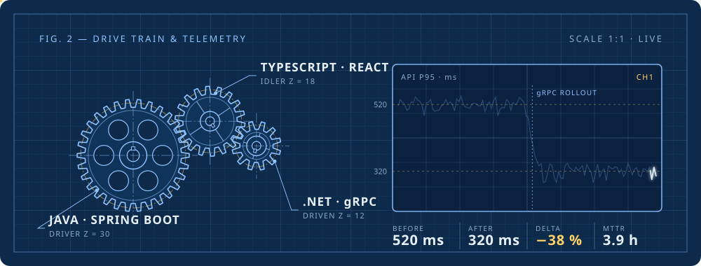

  

  

Stack as text

**Languages** — Java 8–21, TypeScript, JavaScript, C# / .NET, SQL  
**Back end** — Spring Boot (Web, Data JPA, Security), Spring Cloud Config, gRPC, REST, SOAP, OpenAPI  
**Front end** — React, Redux, Ant Design  
**Data** — PostgreSQL, Oracle, Microsoft SQL Server  
**Platform** — Docker, Kubernetes (Helm), RHEL, Ansible, AWS S3, MinIO  
**Delivery** — Azure DevOps, TeamCity, Gradle, SonarQube, JUnit, Mockito  
**Operations** — New Relic, Datadog, Prometheus, alerting, on-call, runbooks, backup and DR  
**Domain** — credit services, Open Banking, fraud and risk, partner onboarding

